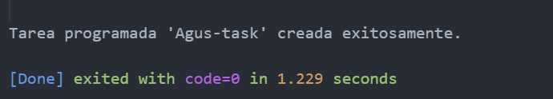

# TaskScheduler.PowerShell
PowerShell scripts that create and remove Windows scheduled tasks with Task Scheduler, as an example of task automation through PowerShell code.

<div align="center">
  
</div>

## What the task does
- Runs an executable **at Windows startup**, after a configurable delay (5 minutes by default).
- Runs as **`NT AUTHORITY\SYSTEM`** with the highest privileges, so it doesn't need a user to be logged in.
- Starts as soon as possible if a scheduled start was missed, and also runs on battery power.
- If a task with the same name already exists, it is replaced.

## Requirements
- Windows 8 / Windows Server 2012 or later
- PowerShell 4.0 or later
- A PowerShell console **run as Administrator**

## Usage 🚀
Open PowerShell as Administrator in the repository folder.

### Register the task
```powershell
powershell -ExecutionPolicy Bypass -File .\Register-Task.ps1 -ExecutablePath "C:\Apps\test.exe"
```

| Parameter         | Default      | Description                                          |
|-------------------|--------------|------------------------------------------------------|
| `-TaskName`       | `Agus-task`  | Name of the task in Task Scheduler                   |
| `-ExecutablePath` | *(required)* | Full path to the executable to run                   |
| `-Argument`       | `-batchmode` | Arguments passed to the executable                   |
| `-DelayMinutes`   | `5`          | Minutes to wait after startup before running         |
| `-RequireNetwork` | off          | Run only when a network connection is available      |
| `-RunNow`         | off          | Also start the task right after registering it       |

Example with every option:
```powershell
.\Register-Task.ps1 -TaskName "MyApp" -ExecutablePath "C:\Apps\test.exe" -Argument "-batchmode" -DelayMinutes 10 -RequireNetwork -RunNow
```

### Check the task
```powershell
Get-ScheduledTask -TaskName "Agus-task" | Get-ScheduledTaskInfo
```

### Remove the task
```powershell
powershell -ExecutionPolicy Bypass -File .\Unregister-Task.ps1 -TaskName "Agus-task"
```

## Result 📈

